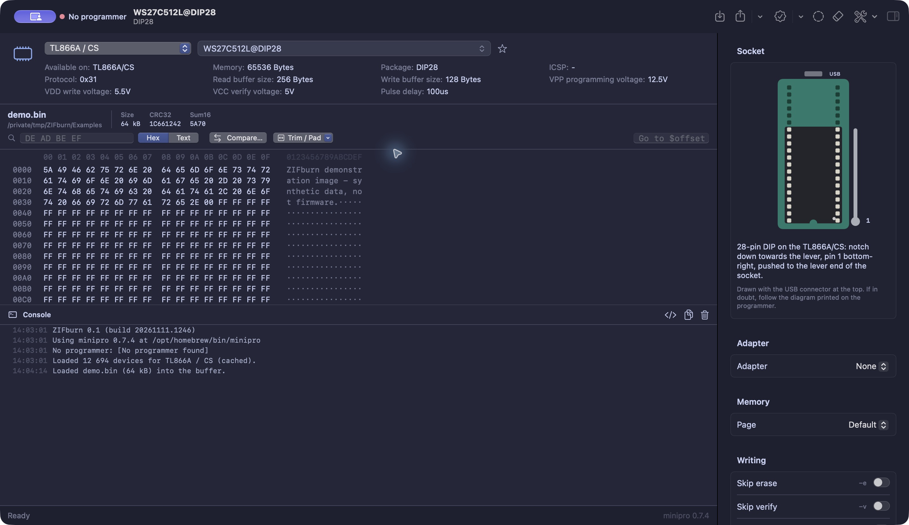

# ZIFburn

A native macOS front-end for [minipro](https://gitlab.com/DavidGriffith/minipro), the open-source driver for XGecu TL866A/CS, TL866II+, T48, T56 and T76 programmers.

It is written in Swift and SwiftUI, with no Qt and no third-party dependencies. It does no USB work of its own: every action runs the `minipro` binary, and the exact command line is shown in the console so you can always reproduce it in a terminal.

*Named after the ZIF (zero insertion force) socket on every TL866 and T48: drop a chip in, flip the lever, burn.*

## Version

Current version: **0.1**. The single source of truth is the `VERSION` file; bundle builds stamp it into `CFBundleShortVersionString`. See `RELEASE.md` for the version checklist.

## Requirements

- macOS 14 Sonoma or later
- Xcode 15+ or the Swift 5.9+ command-line tools
- minipro: `brew install minipro`

## Build

```sh
make app        # builds build/ZIFburn.app (ad-hoc signed)
make run        # build and launch
make install    # copy to /Applications
make universal  # arm64 + x86_64 bundle
make dev        # swift run, no bundle (handy while hacking)
make test       # unit tests for the parsers and formats (needs Xcode, not just the CLT)
make release-plan # show unified release build steps
make release-tests # offline release automation tests
make dist       # source tarball: ../zifburn-<version>-source.tar.gz
```

You can also open `Package.swift` in Xcode and press Run.

The app is not sandboxed, because it has to execute `/opt/homebrew/bin/minipro`. minipro itself talks to USB.

## Features

**Chip selection.** Two select boxes at the top of the window. The **programmer** box picks which minipro chip database to show: Auto (follows the connected programmer, or merges all databases when none is plugged in), TL866A/CS, TL866II+/T48/T56, or T76. The **chip** box looks like a normal pop-up button but opens a searchable dropdown (⌘L). Search matches several words, so `27c512 dip` works, and you can use ↑↓ and ↩ to pick. Favorites and recent chips are listed at the top.

**Device info.** The header shows the parsed `minipro -d` output: package, memory size, protocol, buffer sizes, and so on.

**Programmer status.** The toolbar shows the model and firmware. Plugging the programmer in or out is detected automatically, and you can turn this off in Settings.

**Operations:**
- Read, Write (from the buffer or straight from a .bin, .hex or .srec file), Verify, Blank check and Erase
- Read chip ID, pin contact check, logic IC test
- Auto-detect 8 or 16 pin SPI flash, with a picker for the matches
- Programmer self-test and firmware update

**Socket placement diagram.** The inspector draws the programmer's ZIF socket the way you hold it (USB connector at the top), with the selected chip in place: pin 1, notch direction, which end of the socket the chip goes, and the lever corner, per model (40-pin TL866/T48, 48-pin T56/T76). Packages that don't fit, such as PLCC or SOP, are flagged as needing an adapter. Variants like `24AA512@DFN8`, which minipro places as a DIP8, are drawn on a blue adapter board, with a note to mount the chip on a DFN8 → DIP8 adapter first.

**Bank-switched adapters.** Choose the **27C160/322/400/800 adapter** ([mafe72's open-source design](https://github.com/mafe72/27c160-tl866-adapter)) in the inspector and the chip (27C400, 27C800, 27C160 or 27C322). ZIFburn reads, burns, verifies or blank-checks it as AM27C4096 banks of 512 KB, and before each bank it tells you, and draws, how to set DIP switches 1–3 (A18–A20) and the 27c322/other slide switch. Reads are joined into one image; burns split the buffer into banks automatically, padding with $FF. Switch settings follow the adapter's official table (Part 001 = all switches ON), with a polarity toggle for the later board revision. The chip ID check and pin detection are turned off automatically for adapter jobs, as the adapter's guide requires. There's also an option for 16-bit byte swapping.

**Programming voltages.** VPP, VDD write, VCC verify and pulse delay can be set in the inspector, using exactly the steps `man minipro` lists for your programmer (the TL866A/CS and TL866II+ differ). They're passed as `--vpp=12.5 --pulse=50` and so on when writing, and like every other option they're remembered per chip. minipro applies them only to UV EPROMs and GAL/ATF chips. The adapter section has a one-click preset with the adapter guide's 50 µs pulse and 12.5 V VPP.

**Pin contact check first.** On the TL866II+ and T48, ZIFburn runs `minipro -z` before read, write, verify, erase, blank check and ID read, and stops with a clear message if a pin isn't making contact. It's on by default and can be turned off in the inspector.

**Burn** (⇧⌘B). Blank check, write and verify in one step, with confirmation before programming. Verification is enabled by default and follows the per-chip Skip verify setting. **Burn ROM Set** burns several images to several chips in turn, for example the -hi and -lo halves of a 32-bit Amiga Kickstart (A1200/A4000) on two 27C4096s, asking for each chip. Results state when verification is skipped.

**Duplicate a chip** (⇧⌘D). Read a master chip, then write copies to as many blank chips as you like. Verification follows the per-chip setting.

**Batch write.** Write the buffer to a series of chips with Write Next, Retry and Stop, and a running pass/fail count.

**Stability check** (⇧⌘R). Reads the chip three times and compares the passes. Identical reads confirm the data was consistent across those passes. Otherwise the buffer gets the per-byte majority vote and the flipping bytes are highlighted, which is handy for ageing EPROMs.

**Hex tools.** Find byte patterns (`DE AD BE EF`) or text (⌘F). Compare the buffer with an image file, which highlights every differing byte and notes whether an extra tail is just padding. Trim trailing $FF/$00, or pad to the chip size. Step through matches with ↑/↓. The hex font size is adjustable from the View menu (⌘+ / ⌘− / ⌘0).

**Safety hints.** A warning appears for minipro's `@PACKAGE` device variants, which sometimes carry wrong settings, and USB-related errors come with a reconnect tip.

**Live progress.** minipro's in-place `\r` progress counters drive a real progress bar. Cancel sends SIGINT so minipro can power the socket down cleanly.

**Hex buffer.** The buffer is shown as hex and ASCII, with CRC32, the classic Sum16, fill detection ("all $FF") and a warning when the buffer size doesn't match the chip. Go to an offset with `1FF0`, `$1FF0` or `0x1FF0`. Drag and drop files onto it, and open or save as raw binary or Intel HEX (ZIFburn has its own codec).

**Multi-page chips.** When a read produces EEPROM or fuse files as well as the main image, they are listed and can be shown in Finder.

**Options inspector.** Each switch is labelled with the minipro flag it adds, and is only passed to the operations where it applies. A live preview shows the resulting write command. Options persist between launches.

**Per-chip options.** Inspector options are remembered for each chip. Turn on “Ignore chip ID mismatch” for AM27C4096@DIP40 once, and it's back every time you select that chip. Chips you haven't customised start from the defaults.

**Helpful errors.** Common minipro failures (ID mismatch, file size, overcurrent, failed verify) get a plain-language hint under the hex view, and where it's safe, a one-click fix that runs the operation again: *Ignore ID for This Chip & Retry*, *Pad Buffer & Retry*, and so on.

**One progress bar.** Erase, write and verify run as steps of a single bar ("step 2 of 3") instead of three bars that each go 0–100 %.

**Fast start.** The chip list is cached per minipro version, so launches are instant. Programmer › Reload Device List asks minipro again.

**Safety.** Write, Burn, erase, firmware update and self-test ask for confirmation, a trimmed or padded buffer isn't replaced without asking, with a size-mismatch warning when relevant. All minipro invocations are serialized, so background polling never interferes with a running write.

**Themes.** Pick one from **View › Theme**, or visually in **ZIFburn › Settings… (⌘,) › Appearance**: System, Light and Dark (native macOS colours), the four Catppuccin flavours, Nord, Dracula, Solarized Light and Dark, and two retro CRT themes, Phosphor (green) and Amber. Custom themes recolour the sidebar, hex view, console, inspector, toolbar and status bar, and switching takes effect immediately.

**Readable commands.** The console shows minipro's long option names (`--device AM27C4096@DIP40 --no_id_error --write …`), so a copied command reads like one you'd type yourself.

**Built-in help.** Help › ZIFburn Help (⌘?) covers getting started, workflows, buffer tools, shortcuts and troubleshooting.

**Native UI.** Menus and shortcuts for everything (⌘R read, ⇧⌘W write, ⌘Y verify, ⌘B blank check, ⌘K check programmer, ⌘. cancel). Optional completion sounds, so you can look away while a 27C801 burns.

## App icon

A flat, retro design: an EPROM with a glowing quartz window over 80s sunset stripes, on beige "computer plastic". The source is `Support/Icon/AppIcon.svg` and the master render is `Support/Icon/AppIcon-1024.png`. `Support/AppIcon.icns` is what goes into the bundle. After editing the SVG and re-exporting the PNG, run `make icon` to rebuild the `.icns` with macOS's own `sips` and `iconutil`.

## Layout

```
Sources/ZIFburn/
├── App/        ZIFburnApp (scenes, menus), AppModel (state + all operations)
├── Minipro/    RunningProcess (streaming Process wrapper), OutputParser, MiniproLocator
├── Model/      ProgrammingOptions (flag mapping), Theme (palettes), shared types
├── Util/       Checksum, IntelHex, HexFormatter
└── Views/      Sidebar, header, hex view, console, inspector, settings
```

## Acknowledgements

Several workflow ideas (placement diagram, pin check before operations, duplicate, batch, stability check, diff, trim/pad) were inspired by XGecu's Xgpro/MiniPro software and by [minipro-rs](https://gitlab.com/arcturus8081/minipro-rs). No code was taken from either.


The overall idea of wrapping the minipro CLI came from [twelve-chairs/minipro-gui](https://github.com/twelve-chairs/minipro-gui), a Qt application. No code was taken from it.

## Website and screenshots

The PHP website is included in `public-web/`, with a four-image
gallery covering chip search, the hex buffer, adapter banks and themes, plus
build instructions. Preview it with
`php -S localhost:8080 -t public-web` and run
`make website-check` to check PHP syntax, rendering and assets (requires PHP). See `public-web/README.md` for hosting.



The screenshots use example data with no programmer connected.

## Release and license

ZIFburn is MIT licensed; see `LICENSE`. See `RELEASE.md` for the hardware smoke
test, universal builds, Developer ID signing, notarization, checksums and website
publication. `make release` requires your signing identity and stored keychain
notarization profile. The unified `scripts/release.py` supports plan, build,
check, prepare and explicitly confirmed publication to GitLab and GitHub. See
`docs/RELEASING.md` for configuration, manifest review and resumable uploads.
Settings default to `~/Development/tools/git-release/projects/zifburn.json`,
with persistent tool paths and 1Password or environment credential lookup.
Source-only pushes, exact tag names and a combined release action follow the
BitSkim release workflow. The adapted helpers retain their MIT license notice.
Local builds remain ad-hoc signed by default.

Intel HEX buffer import validates record checksums, types, lengths, end records
and address boundaries, and limits dense expansion to 64 MiB. S-record images
must use direct Write File / Verify Against File, or be converted to binary or
Intel HEX before opening in the buffer. Burn actions require confirmation;
verification follows the Skip verify setting and is reported accordingly.
